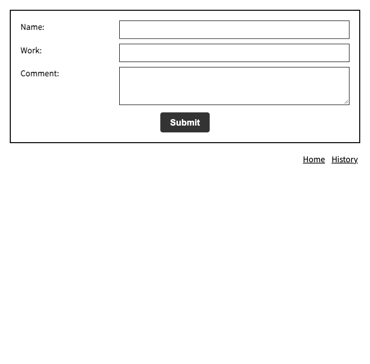

# daily-report（日報アプリ）

名前・作業内容・コメントを入力して日報を送信し、送信済みの日報を一覧で見られる Web アプリです。
学習の課題として、Vite と素の JavaScript、Firebase（Firestore）で作りました。

公開 URL：https://daily-report-5a539.web.app



<!-- スクリーンショットを入れる：History 画面（日報の一覧）。テストデータが写るため現在は未掲載 -->

## できること

- **日報の送信**：Name・Work・Comment を入力して Submit すると、送信した日時と一緒に Cloud Firestore の `reports` コレクションに保存される
- **日報の一覧表示**：History 画面で、保存された日報を Date・name・work・comment の表で見られる
- 画面下部の「Home」「History」リンクで、入力画面と一覧画面を行き来できる

## 使った技術

| 分類 | 技術 |
|---|---|
| 言語 | JavaScript（ES Modules）、HTML／CSS |
| ビルドツール | Vite 8.2.2 |
| データベース | Cloud Firestore（Firebase SDK 12.18.0） |
| 公開 | Firebase Hosting |
| コード整形・検査 | ESLint、Prettier |
| その他 | Git／GitHub |

バージョンは `package-lock.json` に記録されている実際のインストール版です。フレームワークは使っていません。

## 動かし方

1. 依存パッケージをインストールする

   ```bash
   npm install
   ```

2. プロジェクト直下に `.env` を作り、Firebase の設定値を書く。キー名は次の6つ（値は Firebase コンソールのウェブアプリの設定から取得する。`.env` は Git の管理対象外）

   ```
   VITE_API_KEY
   VITE_AUTH_DOMAIN
   VITE_PROJECT_ID
   VITE_STORAGE_BUCKET
   VITE_MESSAGING_SENDER_ID
   VITE_APP_ID
   ```

3. 開発サーバーを起動する

   ```bash
   npm run dev
   ```

### ビルドとデプロイ

```bash
npm run build
firebase deploy
```

`npm run build` で `dist/` に出力され、`firebase.json` の設定で `dist/` が Firebase Hosting の公開対象になります。`firebase deploy` には Firebase CLI のインストールとログインが必要です。

## フォルダ構成

```
.
├── index.html            入力画面
├── history.html          History 画面（日報の一覧）
├── src/
│   ├── main.js           Firebase の初期化と、各画面の処理の呼び出し
│   ├── style.css         スタイル
│   └── sanitize.css      CSS のリセット
├── my-modules/
│   ├── submit-data.js        フォームの内容を Firestore に保存する
│   └── fetch-history-data.js Firestore から日報を取得して表に表示する
├── public/               ファビコンなどの静的ファイル
├── docs/images/          README 用の画像
├── vite.config.js        ビルド設定（index.html と history.html の2ページ）
└── firebase.json         Firebase Hosting の設定
```
